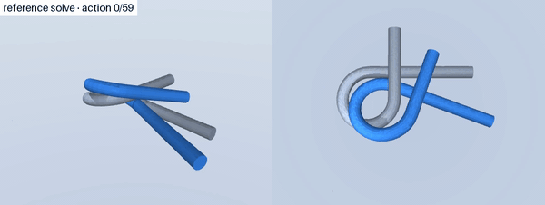

# Loophole

An RL environment (Harbor + MCP) where an LLM agent solves 3D disentanglement puzzles in a
MuJoCo simulation. The agent talks to the simulator only over MCP, from a separate container,
so it never sees the simulator, the solver or the reference. A separate verifier container
replays every logged action in a fresh simulator to score the episode.

<video src="media/clip-rattrap-contrast.mp4" autoplay muted loop playsinline>
  
</video>

<strong>The Rat Trap.</strong> Left: the human teleoperated reference solve, replayed in the simulator; it frees the cord in 284 actions. Right: Kimi K3 Pro, run <code>kimi-20261114-185131</code>: 357 actions, 47 of them blocked moves, 0 of 20 checkpoints. Aligned by action index; once the reference is solved it holds its final frame. <a href="#/media/CLIPS">Clip notes</a>.

## Same model, two puzzles

Gemini 4 Carbon, through the same harness (OpenCode), solved the Alpha puzzle in 3 of 3 runs
and reached 0 of 20 checkpoints on the Rat Trap. On Alpha the winning runs built their own
tools: they rendered depth and segmentation from many viewpoints, reconstructed the tubes,
wrote a motion planner and executed its plan. One setting differs between the two tasks: the Rat Trap runs Gemini at
`thinkingLevel: low`, because at the default level it spent its whole output budget reasoning
and never acted; Alpha uses the default. Details: [Results](RESULTS.md) and the
[repo README](https://github.com/TibiIC/Loophole#readme).

## Results

Placeholder: final results pending.

## Clips

### Alpha 1.0: the reference solve

<video src="media/clip-alpha-reference.mp4" autoplay muted loop playsinline>
  
</video>

The published solution path (Zhang et al. 2020) replayed through the agent's rig, solved in 59 actions. Compressed to about 11 s: fast through the approach and the exit, slowed through the narrow passage (actions 43–56, clearance under 3 mm) where the twist does the work. Left: iso view; right: top view.

### Rat Trap: what failing looks like up close

<video src="media/clip-rattrap-failure.mp4" autoplay muted loop playsinline>
  
</video>

Kimi K3 Pro, run <code>kimi-20261114-185131</code>, actions 45–72: grab a cord node, push, blocked, release, grab another, push again. 11 blocked moves in 28 actions.

### Alpha 1.0: two Gemini runs, one solving

<video src="media/clip-alpha-contrast.mp4" autoplay muted loop playsinline>
  
</video>

Illustrative, not a controlled comparison. Left: <code>sbMy6Ld</code> reconstructed the geometry and planned; solved in 45 actions. Right: <code>Kt5DJ3h</code> descended the cost-to-go signal the original interface exposed; unsolved, stopped at 157 actions. The two runs come from different interface rounds (redesigned vs original observations) and a different grasp tolerance (5 cm vs 3 m). Same puzzle and start pose; aligned by action index.

## Read more

* [Results](RESULTS.md): every evaluation run, strategy classes, behaviour axes and plots.
* [Anomaly diagnosis](ANOMALY.md): how agent runs scored above the oracle.
* [Reward design (Rat Trap)](RATTRAP_DESIGN.md): reference solve, score and checkpoint progress.
* [Exploits](EXPLOITS.md): reward and harness red-team attempts and what stopped each one.
* [Harness notes](HARNESS_NOTES.md): task scope, geometry provenance and licence.
* [Variants](VARIANTS.md): harder puzzles prepared from the published archive.
* [Clip notes](media/CLIPS.md): which run and which actions each clip shows.
* [References](https://github.com/TibiIC/Loophole/blob/HEAD/REFERENCES.md): every citation, checked.
* [Running the code](https://github.com/TibiIC/Loophole#readme): the repo README, for setup and reproduction.
