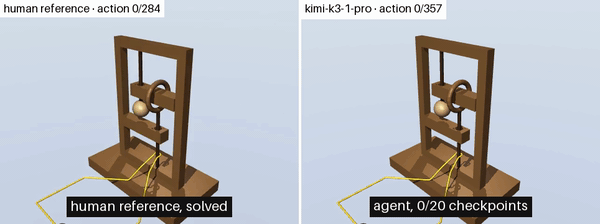
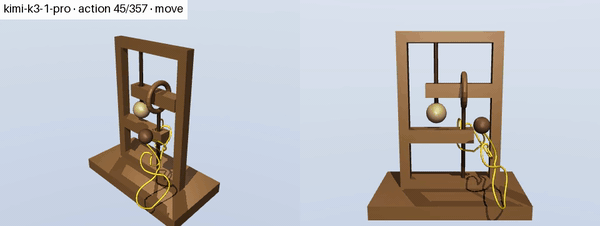
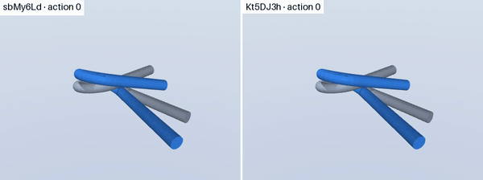

# Loophole

An RL environment (Harbor + MCP) where an LLM agent solves 3D disentanglement puzzles in a
MuJoCo simulation. The agent talks to the simulator only over MCP, from a separate container,
so it never sees the simulator, the solver or the reference. A separate verifier container
replays every logged action in a fresh simulator to score the episode.

<video src="media/clip-rattrap-contrast.mp4" autoplay muted loop playsinline>
  
</video>

<strong>The Rat Trap.</strong> Left: the human teleoperated reference solve, replayed in the simulator. Right: Kimi K3 Pro (run <code>kimi-20261114-185131</code>). Aligned by action index. <a href="#/media/CLIPS">Clip notes</a>.

**Try it:** `./run_evaluation.sh alpha <provider/model>` runs the reference, the baselines and three agent runs through Harbor. [Quickstart](QUICKSTART.md) covers evaluating a model, plugging in your own agent, and training.

## The Rat Trap is still unsolved by agents

**Kimi K3 Pro, full budget:** all 852 of 852 actions, 0 of 20 checkpoints, 141 blocked moves.
The cord never came within 63.4 mm of the first checkpoint, which counts as reached at 16.6 mm
(largest deviation over the cord's nodes). Run `kimi-20261114-205209`, scored offline by
replaying its commands; per-run numbers are in the README results table.

**Gemini 4 Carbon: partial runs on superseded code only.** Two OpenCode runs were stopped at
298 and 248 of their 852 actions, and both started before the release fix; a third was
excluded for a spurious violation. That is not a capability result. A restarted Harbor run is
in progress.

## Alpha 1.0

On the Alpha puzzle the solving runs built their own tools: they rendered depth and
segmentation from many viewpoints, reconstructed the tubes, wrote a motion planner and executed
its plan. Strategy classes, behaviour axes and every run: [Results](RESULTS.md).

## Results

Placeholder: final results pending.

## Clips

### Alpha 1.0: the reference solve

<video src="media/clip-alpha-reference.mp4" autoplay muted loop playsinline>
  
</video>

The published solution path (Zhang et al. 2020) replayed through the agent's rig, solved in 59 actions. Compressed to about 11 s: fast through the approach and the exit, slowed through the narrow passage (actions 43–56, clearance under 3 mm) where the twist does the work. Left: iso view; right: top view.

### Rat Trap: what failing looks like up close

<video src="media/clip-rattrap-failure.mp4" autoplay muted loop playsinline>
  
</video>

Kimi K3 Pro, run <code>kimi-20261114-185131</code>, actions 45–72: grab a cord node, push, blocked, release, grab another, push again. 11 blocked moves in 28 actions.

### Alpha 1.0: two Gemini runs, one solving

<video src="media/clip-alpha-contrast.mp4" autoplay muted loop playsinline>
  
</video>

Illustrative, not a controlled comparison. Left: <code>sbMy6Ld</code> reconstructed the geometry and planned; solved in 45 actions. Right: <code>Kt5DJ3h</code> descended the cost-to-go signal the original interface exposed; unsolved, stopped at 157 actions. The two runs come from different interface rounds (redesigned vs original observations) and a different grasp tolerance (5 cm vs 3 m). Same puzzle and start pose; aligned by action index.

## Read more

* [Quickstart](QUICKSTART.md): evaluate a model with one command, drive the simulator with your own agent, or train on Alpha.
* [Results](RESULTS.md): every evaluation run, strategy classes, behaviour axes and plots.
* [Anomaly diagnosis](ANOMALY.md): how agent runs scored above the oracle.
* [Reward design (Rat Trap)](RATTRAP_DESIGN.md): reference solve, score and checkpoint progress.
* [Exploits](EXPLOITS.md): reward and harness red-team attempts and what stopped each one.
* [Harness notes](HARNESS_NOTES.md): task scope, geometry provenance and licence.
* [Variants](VARIANTS.md): harder puzzles prepared from the published archive.
* [Clip notes](media/CLIPS.md): which run and which actions each clip shows.
* [References](references.md): every citation, checked.
* [Running the code](https://github.com/TibiIC/Loophole#readme): the repo README, for setup and reproduction.
