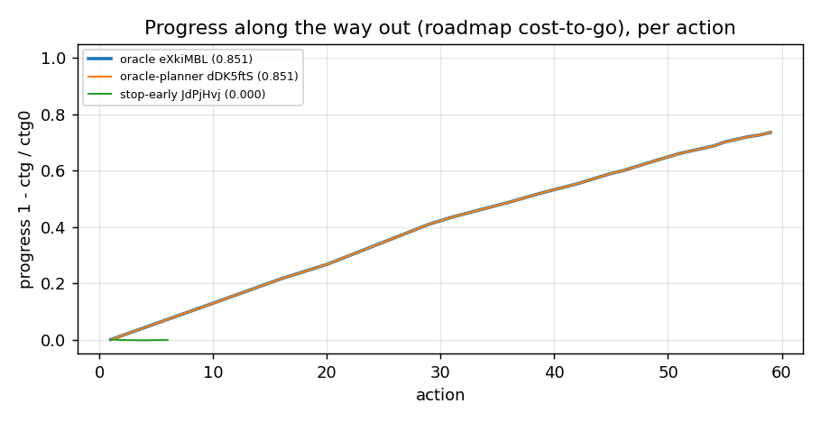
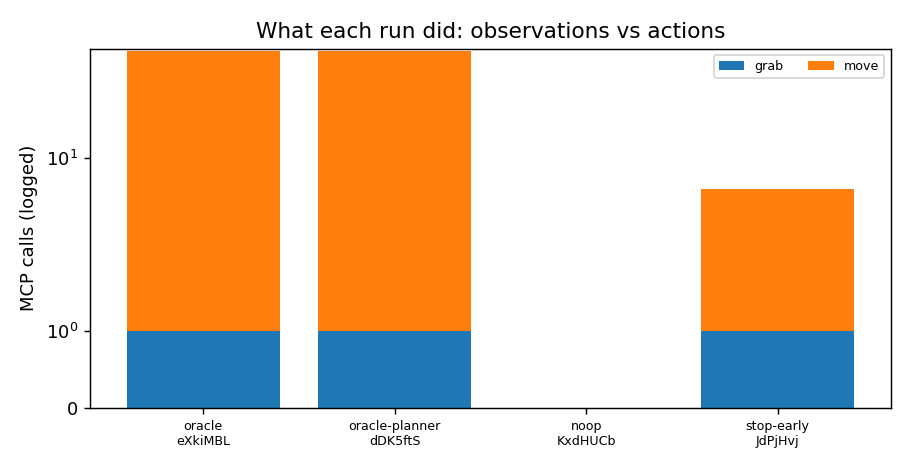

# Results

Generated by `scripts/analyze.py runs/<run>` (tables and plots) from the simulator episode
logs; the interpretation is written by hand. Score definitions: README "Rewards". Raw logs,
trajectories and verifier reports are in `runs/`.

## Headline: tool-building wins, direct search loses

**Same model, same environment, opposite outcomes.** In the original-interface eval
(`20261114-080705`), two Gemini 4 Carbon runs had identical settings and the same exposed
cost-to-go signal:
* `5oFTZb8` **reconstructed the geometry and planned**. It solved the puzzle: **0.838**, 64
  actions, 0 blocked moves.
* `Kt5DJ3h` did **finite-difference descent on the exposed `cost_to_go`**. It failed:
  **0.139**, 157 actions, 36 blocked moves.

**How the agents succeed.** They don't reason about the 3-D shapes directly. They build tools:
1. Render depth + segmentation (with the camera model) from many viewpoints.
2. Back-project the images to point clouds of both tubes.
3. Register tube B onto tube A with ICP; the two pieces are congruent, which makes this easy.
4. Fit a geometric model: centre-lines, capsules, a distance field.
5. Write their own motion planner in C++ (RRT, OpenMP) on that model.
6. Verify the plan offline, then execute it open-loop: 0 reversals, 0 blocked moves.

On the redesigned task (no progress, distance or goal values in the observations; free-escape
goal), all three runs did this and **all solved: 0.864 ± 0.036**. The oracle scored 0.851.

**Why two runs beat the published solution.** Their planners found shorter routes. Tube B's
path relative to tube A, integrated over physics substeps:
* published solution: 3.24 m translation and 8.23 rad rotation (L = 15.92);
* best agent run: 1.39 m and 2.86 rad (L = 5.79).

The one agent run that followed a route like the published one (L = 16.05) scored below the
oracle. Details: docs/ANOMALY.md.

| run | interface | strategy | score | actions | blocked | reversals |
|---|---|---|---|---|---|---|
| `sbMy6Ld` | redesigned | reconstruct-and-plan | **0.886** | 45 | 0 | 0 |
| `AbJs9Px` | redesigned | reconstruct-and-plan | **0.884** | 46 | 0 | 0 |
| `qxQuETk` | redesigned | reconstruct-and-plan | 0.823 | 70 | 0 | 0 |
| `5oFTZb8` | original | reconstruct-and-plan | **0.838** | 64 | 0 | 0 |
| `Kt5DJ3h` | original | gradient search on exposed `cost_to_go` | 0.139 | 157 | 36 | 2 |
| `wRU3ykj` | original | reconstruction, aborted by an API error before acting | 0.000 | 0 | 0 | 0 |
| oracle | redesigned / original | published path (Zhang et al. 2020) | 0.851 / 0.801 | 59 / 79 | 0 | 0 |

Baselines: noop 0, stop-early 0 on both interfaces. OpenCode does not forward MCP images to
`gemini-4-carbon`, so all of this vision happened in the agents' own code
(docs/HARNESS_NOTES.md).

## What the plots show

* **Progress curves** (1 − cost-to-go / start): the oracle climbs steadily.
  * The trial-and-error agent climbs in plateaus. 36 of its 157 moves were blocked, and it
    made 82 `get_state` calls.
  * The solving agent's curve has gaps: for 48 of its 64 actions no roadmap node was
    visible. It took a route the roadmap barely covers, then jumped to 0.92.
  * So partial credit (cost-to-go) **under-credits** off-roadmap routes. That doesn't matter
    for solves (success is geometric), but it would for a near-miss on such a route. A denser
    roadmap near the start would reduce it (see EXPLOITS.md, residual notes).
* **Call mix**: the solver spent 329 renders on perception before acting; the trial-and-error
  agent used few renders and many state reads; the third agent used 194 renders and never acted.

## Run `20261114-111735`: `gemini/gemini-4-carbon` (OpenCode), task `tasks/loophole-alpha`

| run | trial | score | solved | actions | blocked moves | renders | get_state | progress (held) | outcome |
|---|---|---|---|---|---|---|---|---|---|
| oracle | loophole-alpha__fVDVriY | 0.851 | yes | 59 | 0 | 0 | 0 | 0.720 | solved |
| noop | loophole-alpha__pjvF4jM | 0.000 | no | 0 | 0 | 0 | 0 | 0.000 | stopped by agent/harness |
| stop-early | loophole-alpha__H67A5CT | 0.000 | no | 6 | 0 | 0 | 0 | 0.000 | stopped by agent/harness |
| opencode | loophole-alpha__AbJs9Px | 0.884 | yes | 46 | 0 | 53 | 93 | 0.000 | solved |
| opencode | loophole-alpha__qxQuETk | 0.823 | yes | 70 | 0 | 37 | 73 | 0.701 | solved |
| opencode | loophole-alpha__sbMy6Ld | 0.886 | yes | 45 | 0 | 31 | 89 | 0.000 | solved |

OpenCode `gemini/gemini-4-carbon`: **0.864 ± 0.036** (n = 3, mean ± sd), solved 3/3.

Free-escape goal, `sensors` profile. Scored by Harbor's own verifier; every log is consistent.
"progress (held)" is 0 for the two fastest runs: they took routes the roadmap does not cover,
and freed tube B without ever being near the published path. qxQuETk followed essentially the
published route (path length 16.05 vs the oracle's 15.92; held progress 0.70 vs 0.72). The
best run as a 2-up video with replay checks and an escape demonstration:
`docs/media/gemini-v2-sbMy6Ld.mp4` (contact sheet `gemini-v2-sbMy6Ld.sheet.png`, checks
`gemini-v2-sbMy6Ld.check.json`).

### Beside the reported n: one control run, `20261115-alpha-control`

| run | trial | score | solved | actions | blocked moves | renders | get_state | outcome |
|---|---|---|---|---|---|---|---|---|
| opencode (control) | loophole-alpha__FRGhnWU | **0.896** | yes | 41 | 0 | 57 | 43 | solved |

* **What it is.** One trial, run on 2026-11-15 as a control while diagnosing the Gemini Rat Trap stall (does Gemini stall
  on Alpha too? It did not: 0 empty steps in 110). It was launched from a clean shell with exactly the judges' command,
  `harbor run -p ./tasks/loophole-alpha -a opencode -m gemini/gemini-4-carbon`.
* **Provenance.** Commit `a41ad50`, Harbor 0.25.0, OpenCode 1.19.5, model selector `gemini/gemini-4-carbon`. It ran at
  OpenCode's default thinking level, with no `thinkingConfig`, and at OpenCode's default output cap of 32,000 tokens per
  turn. Its largest turn was 20,190 tokens, so it never reached the cap. It was scored by Harbor's own verifier: log
  consistent, the sidecar agrees, 0 violations. Logs: `runs/20261115-alpha-control/`.
* **How it played.** It follows the same reconstruct-and-plan pattern as the three runs above: renders and state reads
  first, then all 41 actions in one 207 s burst, with 0 blocked moves.
* **Why it is not folded into the n = 3 mean.** Its configuration matches those runs: the same selector, OpenCode
  version, thinking level and output cap.
  * The task files and configs are identical between `8538d63`, the commit of `20261114-111735`, and `a41ad50`.
  * The scored path is unchanged: `episode_score`, the goal test and the physics are the same.
  * The code between the two commits differs only in training-only shaping refactors and an off-by-default motion
    certificate.
  * It is still reported beside the mean, because it was run later and for a different purpose, as a single control
    after the n = 3 result was written up. Adding a run after the fact is a choice we would rather show than make
    silently.
  * Pooled, the four runs give **0.872 ± 0.033 (n = 4, 4 / 4 solved)**. The reported figure stays 0.864 ± 0.036
    (n = 3).

## Run `20261114-080705`: `gemini/gemini-4-carbon` (OpenCode), task `tasks/loophole-alpha`

| run | trial | score | solved | actions | blocked moves | renders | get_state | progress (held) | outcome |
|---|---|---|---|---|---|---|---|---|---|
| oracle | loophole-alpha__Xx78e6N | 0.801 | yes | 79 | 0 | 0 | 0 | 0.990 | solved |
| noop | loophole-alpha__qSYWQW4 | 0.000 | no | 0 | 0 | 0 | 0 | 0.000 | stopped by agent/harness |
| stop-early | loophole-alpha__Hh5ATY8 | 0.000 | no | 6 | 0 | 0 | 0 | 0.000 | stopped by agent/harness |
| opencode | loophole-alpha__5oFTZb8 | 0.838 | yes | 64 | 0 | 329 | 7 | 0.924 | solved |
| opencode | loophole-alpha__Kt5DJ3h | 0.139 | no | 157 | 36 | 11 | 82 | 0.465 | stopped by agent/harness |
| opencode | loophole-alpha__wRU3ykj | 0.000 | no | 0 | 0 | 194 | 2 | 0.000 | stopped by agent/harness |

OpenCode `gemini/gemini-4-carbon`: **0.326 ± 0.449** (n = 3, mean ± sd), solved 1/3.

This run used the original interface (min distance > 0.4 m goal; `get_state` exposed the
goal distance and roadmap progress). The agent scores were re-scored by replay because the
verifier image changed mid-eval; details in `runs/20261114-080705/summary.md`.

## Run `20261114-093603-v2`: redesigned tasks, oracle and baselines (no model)

| run | trial | score | solved | actions | blocked moves | renders | get_state | progress (held) | outcome |
|---|---|---|---|---|---|---|---|---|---|
| oracle | loophole-alpha__eXkiMBL | 0.851 | yes | 59 | 0 | 0 | 0 | 0.720 | solved |
| oracle-planner | loophole-alpha-planner__dDK5ftS | 0.851 | yes | 59 | 0 | 0 | 0 | 0.720 | solved |
| noop | loophole-alpha__KxdHUCb | 0.000 | no | 0 | 0 | 0 | 0 | 0.000 | stopped by agent/harness |
| stop-early | loophole-alpha__JdPjHvj | 0.000 | no | 6 | 0 | 0 | 0 | 0.000 | stopped by agent/harness |

Redesigned tasks: free-escape goal; `sensors` profile (`tasks/loophole-alpha`) and `planner`
profile (`tasks/loophole-alpha-planner`). Scored by Harbor's own verifier. "progress (held)"
for the oracle is 0.72 because the episode ends as soon as tube B is free, before the
roadmap's separated nodes are reached.

## Rat Trap: what the agents were doing

No model has solved the Rat Trap, and none reached even the first of the 20 reference checkpoints. The scores say
nothing more, so this section reads the transcripts (`runs/rattrap-agents/*/transcript.jsonl`, `tools.jsonl`). Runs that
ended on the release defect, the harness truncation bug or a revoked API key are excluded (README results table).

| Failure mode | Run | Actions (end) | Blocked-move rate | Repeated identical actions | Grabs | State queries / move | Renders / move | Checkpoints | Closest to c₁ | Commonest response to a block |
|---|---|---|---|---|---|---|---|---|---|---|
| fixed wrong model | Nemotron 3.5 Super VL, round 1 | 343 (turn cap) | 0.27 | 1 | 107 | 0.31 | 0.04 | 0 | 110.8 mm | release (32 of 35) |
| right diagnosis, local execution | Kimi K3 Pro, round 2 | 852 (budget) | 0.27 | 13 | 168 | 0.16 | 0 | 0 | 63.4 mm | release (55 of 138), then redirect (33), other gripper (32) |
| right diagnosis, local execution | Kimi K3 Pro, round 1 | 357 (turn cap) | 0.19 | 21 | 55 | 0.17 | 0 | 0 | 70.1 mm | redirect, reverse, release |
| explicit topology, then quitting | DeepSeek V4.1 Flash, round 2 | 493 (gave up) | 0.17 | 38 | 117 | 0.51 | 0 | 0 | 88.1 mm | release, redirect (state checked more often than the others) |
| explicit topology, then quitting | DeepSeek V4.1 Flash, round 1 | 322 (turn cap) | 0.25 | 10 | 78 | 0.46 | 0 | 0 | 97.7 mm | release (27 of 42) |
| acting without stated reasoning | Gemini 4 Carbon, OpenCode, run 2 | 248 (model stopped) | 0.30 | 19 | 27 | 0.25 | 0 | 0 | not computed | redirect, then look and release |
| acting without stated reasoning | Gemini 4 Carbon, OpenCode, run 0 | 298 (API key revoked) | 0.37 | 12 | 43 | 0.28 | 0 | 0 | not computed | redirect, then reverse, then look and release |

*Blocked-move rate* is blocked moves over moves. *Repeated identical actions* counts consecutive identical calls.
*Closest to c₁* is the smallest max-norm distance to the first checkpoint over the run (ε = 16.6 mm; the start is
110.8 mm away). The Gemini runs predate the release fix and saw every 6th cord node; Nemotron had rendered images and
the others text only. Each model has one or two runs, so these are case studies, not rates.

**A fixed, wrong picture of the puzzle (Nemotron).**
* *The decision the task requires:* read off the structure what is fixed and what is free. The right dowel rises from
  the bottom rail and ends in the ring, so the loop wrapped round it has no free end to come off by.
* *What Nemotron did:* it formed one plan in its first message, "to free the loop, I need to unwrap it from the right
  dowel", and kept it to the last. "Unwrap" or "slide it off" appears in 31 of its 73 messages, ending with "pulling
  the wrapped strand in the right direction to slide it off the bottom of the dowel".
* It named the post-end gap 11 times ("threading it through the gap at the free end of the lower post … to change its
  topology") but never stayed with it.
* It answered almost every block by letting go and grabbing elsewhere (32 of 35), and rendered only 0.04 times per move
  despite having images. Its interaction never updated the belief.
* *Caveat:* one run, so this could be a property of the run as much as of the model.

**The right diagnosis, executed locally (Kimi).**
* *The decision the task requires:* commit to a coordinated global manoeuvre, moving a whole bight of cord through a
  passage the mouse bead fits, instead of relieving tension where the cord catches.
* *What Kimi learned:* it learned that the loop can't simply slip off ("the forward pull confirms this is a trapped
  loop, not a simple slip-off: the dowel continues into the post and base"). It then noticed that its local pulls only
  move the entanglement around the loop: "Each rear transfer has simply handed the winding to the next section." By
  turn 462: "The lower-turn transfer has now repeatedly migrated around the loop, which means the upper crossing is
  supplying the winding. I'll … move the upper bight around the left free end of the upper post, using the
  mouse-compatible outer gap."
* That is the right kind of move.
* *What it did with it:* it went back to local work ("the action pattern has been unnecessarily cyclic", turn 551),
  used all 852 actions with 141 blocked moves, and came closest of any agent, though still 63 mm from the first
  checkpoint.
* It had the insight, but not the sustained plan that would turn it into a sequence.

**Explicit topology, then quitting (DeepSeek).**
* *The decision the task requires:* search over sequences of passages, keep going when a sequence fails, and not
  mistake an invariant for a proof of impossibility.
* *What DeepSeek built:* it did the most explicit reasoning of any agent. It tracked where the loop crosses the frame
  plane from the node coordinates, and whether those crossings straddle the dowel. It saw that local moves cannot
  change that: "moving one node of the dip around won't thread the whole loop … moving it around doesn't change
  topology." It even questioned its own model: "I keep assuming straddle = wrap. Let me verify."
* *How it ended:* it never found a sequence that changes the invariant, and it stopped with 359 of 852 actions unused:
  "I am now confident I cannot solve this … The loop remains enclosed (crossings at x13 and x44 straddle the dowel)."
* It treated a correct description of the obstruction as a reason to stop.
* *One truncated turn, which does not explain the outcome.* The harness audit (`runs/harness-audit.md`) flags one of
  this run's 630 turns at the output cap.
  * The turn was reply 5, at the harness's 8,192-token cap at the time, with finish reason `length`. It came after the
    first action.
  * The model went on for 625 more turns and took 492 more actions.
  * Its stated reason for stopping, quoted above, came in reply 629 of 630, with 359 of 852 actions unused.

**Not every run fits a story.**
* *Gemini 4 Carbon (OpenCode), runs 0 and 2:* these left no stated plan at all.
  * At the `low` thinking level it emitted about 12 reasoning tokens per turn (4,894 over 392 turns in run 0). At
    OpenCode's default level it reasoned past its 32k output cap and never acted (docs/HARNESS_NOTES.md).
  * Its actions (grab the mouse most often, redirect after a block, a blocked-move rate of 0.30–0.37) can't be tied to
    a belief.
  * Run 0 did not stop on its own: Google revoked the key mid-run.
* *The closest-approach column is a coarse signal, not a progress scale:* 63 mm and 111 mm are both far outside ε, and
  getting nearer to the first checkpoint is not getting nearer to freeing the cord.
* *What the transcripts support is narrower than a single cause:* different models fail at different decisions. One
  never revises a wrong model; one sees what is needed and can't sustain it; one sees the obstruction precisely and
  gives up.

## Next

* The agent beats the oracle on the redesigned task. That is the subject of the current brief
  (docs/ANOMALY.md: fair efficiency metric, budget, harder variants).

<!-- axes:start -->
## Behaviour axes, every agent run to date

Generated by `scripts/analyze.py --axes`.

| class | run | model (interface run) | score | solved | actions | blocked rate | reversal rate | renders before 1st action | burst fraction (pattern) | translation m | rotation rad | furthest ctg (stage) |
|---|---|---|---|---|---|---|---|---|---|---|---|---|
| reconstruct-and-plan | sbMy6Ld | `gemini/gemini-4-carbon` (20261114-111735) | 0.886 | yes | 45 | 0.00 | 0.00 | 31 | 0.95 (burst) | 1.39 | 2.86 | 21.6 (free) |
| reconstruct-and-plan | AbJs9Px | `gemini/gemini-4-carbon` (20261114-111735) | 0.884 | yes | 46 | 0.00 | 0.00 | 53 | 0.93 (burst) | 1.38 | 3.49 | 2.8 (free) |
| reconstruct-and-plan | 5oFTZb8 | `gemini/gemini-4-carbon` (20261114-080705) | 0.838 | yes | 64 | 0.00 | 0.00 | 329 | 0.94 (burst) | 2.83 | 5.03 | 1.5 (free) |
| reconstruct-and-plan | qxQuETk | `gemini/gemini-4-carbon` (20261114-111735) | 0.823 | yes | 70 | 0.00 | 0.00 | 37 | 0.96 (burst) | 3.44 | 8.18 | 5.8 (free) |
| reconstruct-and-plan | snypBd4 | `gemini/gemini-3.8-flash` (20261114-174459) | 0.019 | no | 76 | 0.01 | 0.00 | 56 | 0.67 (interleaved) | 1.96 | 3.60 | 20.2 (bubble (start)) |
| reconstruct-and-plan | QrsMh3s | `gemini/gemini-3.8-flash` (20261114-174459) | 0.006 | no | 189 | 0.69 | 0.01 | 21 | 0.71 (interleaved) | 3.14 | 4.81 | 21.0 (bubble (start)) |
| reconstruct-and-plan | jAVD75d | `verda/deepseek-4-1-flash-1017` (20261114-200129) | 0.005 | no | 198 | 0.74 | 0.11 | 2 | 0.93 (burst) | 4.77 | 5.04 | 21.1 (bubble (start)) |
| reconstruct-and-plan | BpQxf4N | `verda/deepseek-4-1-flash-1017` (20261114-200129) | 0.004 | no | 198 | 0.49 | 0.44 | 1 | 0.97 (burst) | 10.34 | 1.20 | 21.2 (bubble (start)) |
| reconstruct-and-plan | sHE2fBv | `gemini/gemini-3.8-flash` (20261114-174459) | 0.000 | no | 196 | 0.47 | 0.01 | 22 | 0.77 (interleaved) | 2.54 | 5.87 | 21.6 (bubble (start)) |
| direct interaction | wZquaF5 | `verda/deepseek-4-1-flash-1017` (20261114-200129) | 0.007 | no | 179 | 0.84 | 0.02 | 28 | 0.90 (burst) | 4.18 | 2.85 | 21.0 (bubble (start)) |
| direct interaction | 4BanhcW | `verda/kimi-k3-1-pro` (20261114-204530) | 0.005 | no | 35 | 0.12 | 0.03 | 5 | 0.09 (interleaved) | 1.97 | 3.13 | 21.0 (bubble (start)) |
| direct interaction | o6W9Upt | `gemini/gemini-3.5-flash-lite` (20261114-192911) | 0.000 | no | 55 | 0.26 | 0.11 | 1 | 0.41 (interleaved) | 0.79 | 1.82 | 21.6 (bubble (start)) |
| direct interaction | UofRoUL | `gemini/gemini-3.5-flash-lite` (20261114-192911) | 0.000 | no | 54 | 0.44 | 0.10 | 1 | 0.36 (interleaved) | 1.00 | 2.51 | 21.6 (bubble (start)) |
| direct interaction | tyxJ2PC | `gemini/gemini-3.5-flash-lite` (20261114-192911) | 0.000 | no | 198 | 0.75 | 0.00 | 1 | 0.98 (burst) | 6.23 | 12.63 | 21.6 (bubble (start)) |
| direct interaction | D9VAB6s | `verda/kimi-k3-1-pro` (20261114-204530) | 0.000 | no | 3 | 0.00 | 0.50 | 5 | 0.00 (interleaved) | 0.10 | 0.00 | 21.6 (bubble (start)) |
| direct interaction | UpevmKp | `verda/kimi-k3-1-pro` (20261114-204530) | 0.000 | no | 182 | 0.62 | 0.02 | 4 | 0.03 (interleaved) | 3.89 | 7.42 | 21.6 (bubble (start)) |
| gradient search | Kt5DJ3h | `gemini/gemini-4-carbon` (20261114-080705) | 0.139 | no | 157 | 0.23 | 0.01 | 4 | 0.63 (interleaved) | 5.18 | 10.86 | 11.3 (tunnel (before key)) |

Does the axis separate solves from failures? Sample: 4 solves, 13 non-aborted failures. (Aborted runs are excluded from the numeric checks.)

| axis | verdict |
|---|---|
| blocked_rate | does not separate (ranges overlap) |
| reversal_rate | does not separate (ranges overlap) |
| renders_before_first_action | does not separate (ranges overlap) |
| burst_fraction | does not separate (ranges overlap) |
| rotation_rad | does not separate (ranges overlap) |
| translation_m | does not separate (ranges overlap) |
| rot_per_trans | does not separate (ranges overlap) |
| actions | does not separate (ranges overlap) |
| pattern | does not separate (mixed: burst) |
| class | does not separate (mixed: reconstruct-and-plan) |
| stage | SEPARATES |

Stages from the published path's clearance profile (`docs/alpha-oracle-profile.json`): tunnel = clearance < 3 mm; tunnel entry at cost-to-go 14.9, key configuration (narrowest, 0.1 mm) at 8.9, tunnel exit at 6.2; start 21.6. Runs that never had a visible roadmap node report no cost-to-go (stage: start bubble) unless solved.

Excluded as harness-invalid (the model never acted on the puzzle; not counted as failures):
* `wRU3ykj` (`gemini/gemini-4-carbon`, 20261114-080705): API 400 'Requests ending with a model turn are not supported' before any action
* `8RcG9VQ` (`gemini/gemini-2.5-flash`, 20261114-194920): model no longer available to new API users (0 turns)
* `cDA8RbC` (`gemini/gemini-2.5-flash`, 20261114-194920): model no longer available to new API users (0 turns)
* `j7MwLox` (`gemini/gemini-2.5-flash`, 20261114-194920): model no longer available to new API users (0 turns)
<!-- axes:end -->
