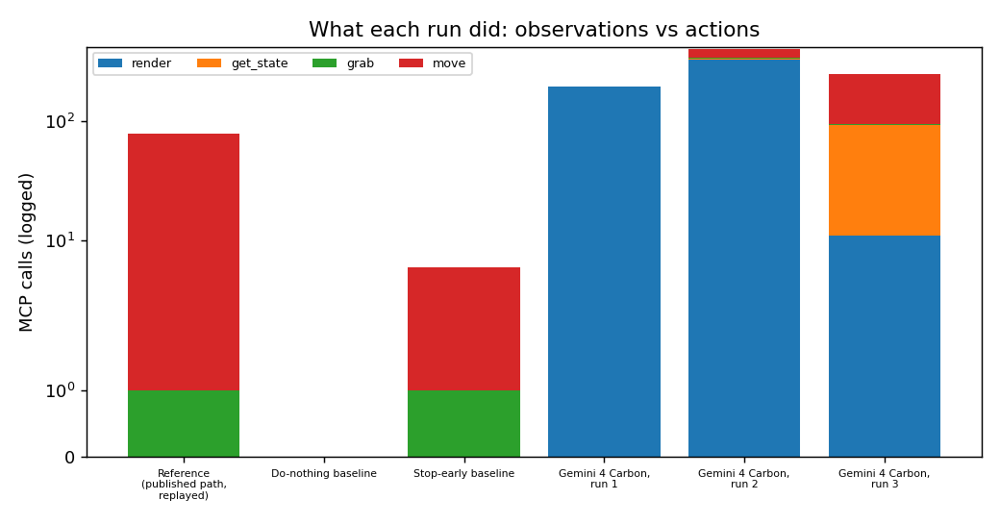

# Results

Generated by `scripts/analyze.py runs/<run>` (tables and plots) from the simulator episode
logs; the interpretation is written by hand. Score definitions: README "Rewards". Raw logs,
trajectories and verifier reports are in `runs/`.

## Headline: tool-building wins, direct search loses

**Same model, same environment, opposite outcomes.** In the original-interface eval
(`20261114-080705`), two Gemini 4 Carbon runs had identical settings and the same exposed
cost-to-go signal:
* `5oFTZb8` **reconstructed the geometry and planned**. It solved the puzzle: **0.838**, 64
  actions, 0 blocked moves.
* `Kt5DJ3h` did **finite-difference descent on the exposed `cost_to_go`**. It failed:
  **0.139**, 157 actions, 36 blocked moves.

**How the agents succeed.** They don't reason about the 3-D shapes directly. They build tools:
1. Render depth + segmentation (with the camera model) from many viewpoints.
2. Back-project the images to point clouds of both tubes.
3. Register tube B onto tube A with ICP; the two pieces are congruent, which makes this easy.
4. Fit a geometric model: centre-lines, capsules, a distance field.
5. Write their own motion planner in C++ (RRT, OpenMP) on that model.
6. Verify the plan offline, then execute it open-loop: 0 reversals, 0 blocked moves.

On the redesigned task (no progress, distance or goal values in the observations; free-escape
goal), all three runs did this and **all solved: 0.864 ± 0.036**. The oracle scored 0.851.

**Why two runs beat the published solution.** Their planners found shorter routes. Tube B's
path relative to tube A, integrated over physics substeps:
* published solution: 3.24 m translation and 8.23 rad rotation (L = 15.92);
* best agent run: 1.39 m and 2.86 rad (L = 5.79).

The one agent run that followed a route like the published one (L = 16.05) scored below the
oracle. Details: docs/ANOMALY.md.

| run | interface | strategy | score | actions | blocked | reversals |
|---|---|---|---|---|---|---|
| `sbMy6Ld` | redesigned | reconstruct-and-plan | **0.886** | 45 | 0 | 0 |
| `AbJs9Px` | redesigned | reconstruct-and-plan | **0.884** | 46 | 0 | 0 |
| `qxQuETk` | redesigned | reconstruct-and-plan | 0.823 | 70 | 0 | 0 |
| `5oFTZb8` | original | reconstruct-and-plan | **0.838** | 64 | 0 | 0 |
| `Kt5DJ3h` | original | gradient search on exposed `cost_to_go` | 0.139 | 157 | 36 | 2 |
| `wRU3ykj` | original | reconstruction, aborted by an API error before acting | 0.000 | 0 | 0 | 0 |
| oracle | redesigned / original | published path (Zhang et al. 2020) | 0.851 / 0.801 | 59 / 79 | 0 | 0 |

Baselines: noop 0, stop-early 0 on both interfaces. OpenCode does not forward MCP images to
`gemini-4-carbon`, so all of this vision happened in the agents' own code
(docs/HARNESS_NOTES.md).

## What the plots show

* **Progress curves** (1 − cost-to-go / start): the oracle climbs steadily.
  * The trial-and-error agent climbs in plateaus. 36 of its 157 moves were blocked, and it
    made 82 `get_state` calls.
  * The solving agent's curve has gaps: for 48 of its 64 actions no roadmap node was
    visible. It took a route the roadmap barely covers, then jumped to 0.92.
  * So partial credit (cost-to-go) **under-credits** off-roadmap routes. That doesn't matter
    for solves (success is geometric), but it would for a near-miss on such a route. A denser
    roadmap near the start would reduce it (see EXPLOITS.md, residual notes).
* **Call mix**: the solver spent 329 renders on perception before acting; the trial-and-error
  agent used few renders and many state reads; the third agent used 194 renders and never acted.

## Run `20261114-111735`: `gemini/gemini-4-carbon` (OpenCode), task `tasks/loophole-alpha`

| run | trial | score | solved | actions | blocked moves | renders | get_state | progress (held) | outcome |
|---|---|---|---|---|---|---|---|---|---|
| oracle | loophole-alpha__fVDVriY | 0.851 | yes | 59 | 0 | 0 | 0 | 0.720 | solved |
| noop | loophole-alpha__pjvF4jM | 0.000 | no | 0 | 0 | 0 | 0 | 0.000 | stopped by agent/harness |
| stop-early | loophole-alpha__H67A5CT | 0.000 | no | 6 | 0 | 0 | 0 | 0.000 | stopped by agent/harness |
| opencode | loophole-alpha__AbJs9Px | 0.884 | yes | 46 | 0 | 53 | 93 | 0.000 | solved |
| opencode | loophole-alpha__qxQuETk | 0.823 | yes | 70 | 0 | 37 | 73 | 0.701 | solved |
| opencode | loophole-alpha__sbMy6Ld | 0.886 | yes | 45 | 0 | 31 | 89 | 0.000 | solved |

OpenCode `gemini/gemini-4-carbon`: **0.864 ± 0.036** (n = 3, mean ± sd), solved 3/3.

Free-escape goal, `sensors` profile. Scored by Harbor's own verifier; every log is consistent.
"progress (held)" is 0 for the two fastest runs: they took routes the roadmap does not cover,
and freed tube B without ever being near the published path. qxQuETk followed essentially the
published route (path length 16.05 vs the oracle's 15.92; held progress 0.70 vs 0.72). The
best run as a 2-up video with replay checks and an escape demonstration:
`docs/media/gemini-v2-sbMy6Ld.mp4` (contact sheet `gemini-v2-sbMy6Ld.sheet.png`, checks
`gemini-v2-sbMy6Ld.check.json`).

## Run `20261114-080705`: `gemini/gemini-4-carbon` (OpenCode), task `tasks/loophole-alpha`

| run | trial | score | solved | actions | blocked moves | renders | get_state | progress (held) | outcome |
|---|---|---|---|---|---|---|---|---|---|
| oracle | loophole-alpha__Xx78e6N | 0.801 | yes | 79 | 0 | 0 | 0 | 0.990 | solved |
| noop | loophole-alpha__qSYWQW4 | 0.000 | no | 0 | 0 | 0 | 0 | 0.000 | stopped by agent/harness |
| stop-early | loophole-alpha__Hh5ATY8 | 0.000 | no | 6 | 0 | 0 | 0 | 0.000 | stopped by agent/harness |
| opencode | loophole-alpha__5oFTZb8 | 0.838 | yes | 64 | 0 | 329 | 7 | 0.924 | solved |
| opencode | loophole-alpha__Kt5DJ3h | 0.139 | no | 157 | 36 | 11 | 82 | 0.465 | stopped by agent/harness |
| opencode | loophole-alpha__wRU3ykj | 0.000 | no | 0 | 0 | 194 | 2 | 0.000 | stopped by agent/harness |

OpenCode `gemini/gemini-4-carbon`: **0.326 ± 0.449** (n = 3, mean ± sd), solved 1/3.

This run used the original interface (min distance > 0.4 m goal; `get_state` exposed the
goal distance and roadmap progress). The agent scores were re-scored by replay because the
verifier image changed mid-eval; details in `runs/20261114-080705/summary.md`.

## Run `20261114-093603-v2`: redesigned tasks, oracle and baselines (no model)

| run | trial | score | solved | actions | blocked moves | renders | get_state | progress (held) | outcome |
|---|---|---|---|---|---|---|---|---|---|
| oracle | loophole-alpha__eXkiMBL | 0.851 | yes | 59 | 0 | 0 | 0 | 0.720 | solved |
| oracle-planner | loophole-alpha-planner__dDK5ftS | 0.851 | yes | 59 | 0 | 0 | 0 | 0.720 | solved |
| noop | loophole-alpha__KxdHUCb | 0.000 | no | 0 | 0 | 0 | 0 | 0.000 | stopped by agent/harness |
| stop-early | loophole-alpha__JdPjHvj | 0.000 | no | 6 | 0 | 0 | 0 | 0.000 | stopped by agent/harness |

Redesigned tasks: free-escape goal; `sensors` profile (`tasks/loophole-alpha`) and `planner`
profile (`tasks/loophole-alpha-planner`). Scored by Harbor's own verifier. "progress (held)"
for the oracle is 0.72 because the episode ends as soon as tube B is free, before the
roadmap's separated nodes are reached.

## Next

* The agent beats the oracle on the redesigned task. That is the subject of the current brief
  (docs/ANOMALY.md: fair efficiency metric, budget, harder variants).

<!-- axes:start -->
## Behaviour axes, every agent run to date

Generated by `scripts/analyze.py --axes`.

| class | run | model (interface run) | score | solved | actions | blocked rate | reversal rate | renders before 1st action | burst fraction (pattern) | translation m | rotation rad | furthest ctg (stage) |
|---|---|---|---|---|---|---|---|---|---|---|---|---|
| reconstruct-and-plan | sbMy6Ld | `gemini/gemini-4-carbon` (20261114-111735) | 0.886 | yes | 45 | 0.00 | 0.00 | 31 | 0.95 (burst) | 1.39 | 2.86 | 21.6 (free) |
| reconstruct-and-plan | AbJs9Px | `gemini/gemini-4-carbon` (20261114-111735) | 0.884 | yes | 46 | 0.00 | 0.00 | 53 | 0.93 (burst) | 1.38 | 3.49 | 2.8 (free) |
| reconstruct-and-plan | 5oFTZb8 | `gemini/gemini-4-carbon` (20261114-080705) | 0.838 | yes | 64 | 0.00 | 0.00 | 329 | 0.94 (burst) | 2.83 | 5.03 | 1.5 (free) |
| reconstruct-and-plan | qxQuETk | `gemini/gemini-4-carbon` (20261114-111735) | 0.823 | yes | 70 | 0.00 | 0.00 | 37 | 0.96 (burst) | 3.44 | 8.18 | 5.8 (free) |
| gradient search | Kt5DJ3h | `gemini/gemini-4-carbon` (20261114-080705) | 0.139 | no | 157 | 0.23 | 0.01 | 4 | 0.63 (interleaved) | 5.18 | 10.86 | 11.3 (tunnel (before key)) |
| aborted / no action | wRU3ykj | `gemini/gemini-4-carbon` (20261114-080705) | 0.000 | no | 0 | – | – | 194 | – (–) | 0 | 0.00 | – (bubble (start)) |

Does the axis separate solves from failures? Sample: 4 solves, 1 non-aborted failures - too few failures for any verdict to be a real signal yet. (Aborted runs are excluded from the numeric checks.)

| axis | verdict |
|---|---|
| blocked_rate | SEPARATES |
| reversal_rate | SEPARATES |
| renders_before_first_action | SEPARATES |
| burst_fraction | SEPARATES |
| rotation_rad | SEPARATES |
| translation_m | SEPARATES |
| rot_per_trans | does not separate (ranges overlap) |
| actions | SEPARATES |
| pattern | SEPARATES |
| class | SEPARATES |
| stage | SEPARATES |

Stages from the published path's clearance profile (`docs/alpha-oracle-profile.json`): tunnel = clearance < 3 mm; tunnel entry at cost-to-go 14.9, key configuration (narrowest, 0.1 mm) at 8.9, tunnel exit at 6.2; start 21.6. Runs that never had a visible roadmap node report no cost-to-go (stage: start bubble) unless solved.
<!-- axes:end -->
