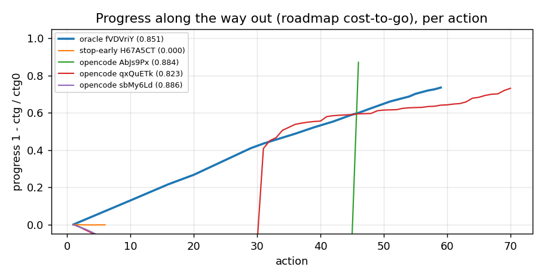
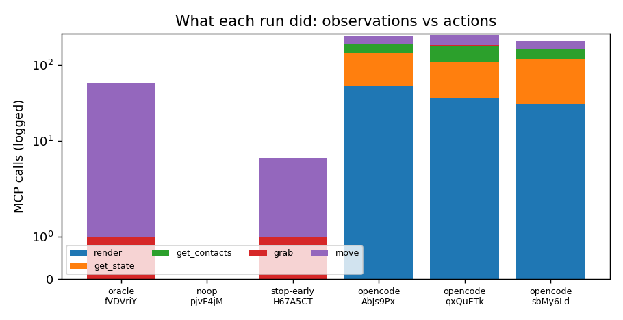
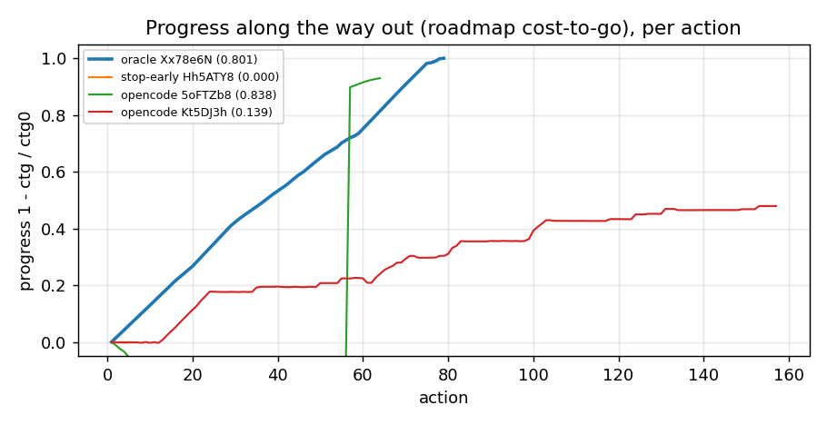

# Results

Generated by `scripts/analyze.py runs/<run>` (tables and plots) from the simulator episode
logs; the interpretation is written by hand. Score definitions: README "Rewards". Raw logs,
trajectories and verifier reports are in `runs/`.

## Headline

* **Redesigned task** (`tasks/loophole-alpha`: `sensors` profile, free-escape goal, no
  progress or distance in the observations), run `20261114-111735`:
  * Gemini 4 Carbon (OpenCode) **solved Alpha 1.0 in 3/3 runs**, **0.864 ± 0.036**: 45, 46 and
    70 actions.
  * Oracle 0.851 (59 actions), noop 0, stop-early 0.
  * All three logs were verified bit-exactly by Harbor's verifier.
  * The two best runs score above the oracle. docs/ANOMALY.md diagnoses why: perception
    (metric depth + segmentation → point clouds → ICP), then their own C++ planner, then
    open-loop execution. Their paths are 2.4–2.7× shorter in SE(3) than the published one.
    There was no search on any progress signal (none is exposed) and no probing: 0 reversals,
    0 blocked moves.
* **Original interface** (min distance > 0.4 m goal, progress exposed), run `20261114-080705`:
  0.326 ± 0.449, solved 1/3.
  * One run (0.838) decoded the PNGs itself, space-carved both tubes from 50+ renders and
    planned in C++.
  * One run did finite-difference descent on the exposed cost-to-go and failed (0.139).
  * One run ended on a Gemini API error.
* OpenCode does not forward MCP images to `gemini-4-carbon`. All agents did their vision in
  code (HARNESS_NOTES.md).

## What the plots show

* **Progress curves** (1 − cost-to-go / start): the oracle climbs steadily.
  * The trial-and-error agent climbs in plateaus. 36 of its 157 moves were blocked, and it
    made 82 `get_state` calls.
  * The solving agent's curve has gaps: for 48 of its 64 actions no roadmap node was
    visible. It took a route the roadmap barely covers, then jumped to 0.92.
  * So partial credit (cost-to-go) **under-credits** off-roadmap routes. That doesn't matter
    for solves (success is geometric), but it would for a near-miss on such a route. A denser
    roadmap near the start would reduce it (see EXPLOITS.md, residual notes).
* **Call mix**: the solver spent 329 renders on perception before acting; the trial-and-error
  agent used few renders and many state reads; the third agent used 194 renders and never acted.

## Run `20261114-111735`: `gemini/gemini-4-carbon` (OpenCode), task `tasks/loophole-alpha`

| run | trial | score | solved | actions | blocked moves | renders | get_state | progress (held) | outcome |
|---|---|---|---|---|---|---|---|---|---|
| oracle | loophole-alpha__fVDVriY | 0.851 | yes | 59 | 0 | 0 | 0 | 0.720 | solved |
| noop | loophole-alpha__pjvF4jM | 0.000 | no | 0 | 0 | 0 | 0 | 0.000 | stopped by agent/harness |
| stop-early | loophole-alpha__H67A5CT | 0.000 | no | 6 | 0 | 0 | 0 | 0.000 | stopped by agent/harness |
| opencode | loophole-alpha__AbJs9Px | 0.884 | yes | 46 | 0 | 53 | 93 | 0.000 | solved |
| opencode | loophole-alpha__qxQuETk | 0.823 | yes | 70 | 0 | 37 | 73 | 0.701 | solved |
| opencode | loophole-alpha__sbMy6Ld | 0.886 | yes | 45 | 0 | 31 | 89 | 0.000 | solved |

OpenCode `gemini/gemini-4-carbon`: **0.864 ± 0.036** (n = 3, mean ± sd), solved 3/3.

Free-escape goal, `sensors` profile. Scored by Harbor's own verifier; every log is consistent.
"progress (held)" is 0 for the two fastest runs: they took routes the roadmap does not cover,
and freed tube B without ever being near the published path. qxQuETk followed essentially the
published route (path length 16.05 vs the oracle's 15.92; held progress 0.70 vs 0.72). The
best run as a 2-up video with replay checks and an escape demonstration:
`docs/media/gemini-v2-sbMy6Ld.mp4` (contact sheet `gemini-v2-sbMy6Ld.sheet.png`, checks
`gemini-v2-sbMy6Ld.check.json`).

## Run `20261114-080705`: `gemini/gemini-4-carbon` (OpenCode), task `tasks/loophole-alpha`

| run | trial | score | solved | actions | blocked moves | renders | get_state | progress (held) | outcome |
|---|---|---|---|---|---|---|---|---|---|
| oracle | loophole-alpha__Xx78e6N | 0.801 | yes | 79 | 0 | 0 | 0 | 0.990 | solved |
| noop | loophole-alpha__qSYWQW4 | 0.000 | no | 0 | 0 | 0 | 0 | 0.000 | stopped by agent/harness |
| stop-early | loophole-alpha__Hh5ATY8 | 0.000 | no | 6 | 0 | 0 | 0 | 0.000 | stopped by agent/harness |
| opencode | loophole-alpha__5oFTZb8 | 0.838 | yes | 64 | 0 | 329 | 7 | 0.924 | solved |
| opencode | loophole-alpha__Kt5DJ3h | 0.139 | no | 157 | 36 | 11 | 82 | 0.465 | stopped by agent/harness |
| opencode | loophole-alpha__wRU3ykj | 0.000 | no | 0 | 0 | 194 | 2 | 0.000 | stopped by agent/harness |

OpenCode `gemini/gemini-4-carbon`: **0.326 ± 0.449** (n = 3, mean ± sd), solved 1/3.

This run used the original interface (min distance > 0.4 m goal; `get_state` exposed the
goal distance and roadmap progress). The agent scores were re-scored by replay because the
verifier image changed mid-eval; details in `runs/20261114-080705/summary.md`.

## Run `20261114-093603-v2`: redesigned tasks, oracle and baselines (no model)

| run | trial | score | solved | actions | blocked moves | renders | get_state | progress (held) | outcome |
|---|---|---|---|---|---|---|---|---|---|
| oracle | loophole-alpha__eXkiMBL | 0.851 | yes | 59 | 0 | 0 | 0 | 0.720 | solved |
| oracle-planner | loophole-alpha-planner__dDK5ftS | 0.851 | yes | 59 | 0 | 0 | 0 | 0.720 | solved |
| noop | loophole-alpha__KxdHUCb | 0.000 | no | 0 | 0 | 0 | 0 | 0.000 | stopped by agent/harness |
| stop-early | loophole-alpha__JdPjHvj | 0.000 | no | 6 | 0 | 0 | 0 | 0.000 | stopped by agent/harness |

Redesigned tasks: free-escape goal; `sensors` profile (`tasks/loophole-alpha`) and `planner`
profile (`tasks/loophole-alpha-planner`). Scored by Harbor's own verifier. "progress (held)"
for the oracle is 0.72 because the episode ends as soon as tube B is free, before the
roadmap's separated nodes are reached.

## Next

* The agent beats the oracle on the redesigned task. That is the subject of the current brief
  (docs/ANOMALY.md: fair efficiency metric, budget, harder variants).
